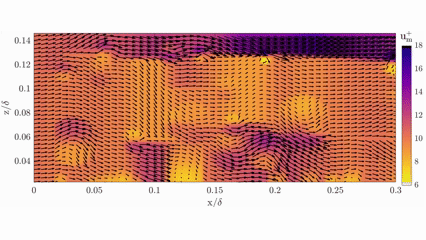

# Stochastic Generation of 2D-TBL Velocity Field

Tools to stochastically generate turbulent boundary-layer (TBL) velocity fields—from synthetic profile generation through reorganization and vortex addition. Available for MATLAB and Python. Find details about the model in the following paper:

1. https://www.cambridge.org/core/journals/journal-of-fluid-mechanics/article/stochastic-modelling-of-the-instantaneous-velocity-profile-in-roughwall-turbulent-boundary-layers/492F3CD03C8C3E7ED306E9117B848B5E

2. https://www.cambridge.org/core/journals/journal-of-fluid-mechanics/article/stochastic-modal-velocity-field-in-roughwall-turbulence/800D97E60609F4FE4D92847CCDB1C7A0

3. https://www.cambridge.org/core/journals/journal-of-fluid-mechanics/article/stochastic-generation-of-velocity-fields-to-reproduce-the-energy-spectrum-in-wall-turbulence/1D7BDC29D1D577DAE7672E86E21641B7

4. https://journals.ametsoc.org/view/journals/bams/105/1/BAMS-D-23-0066.1.xml

## Contents
- [MATLAB package](#matlab-package)
- [Python package](#python-package)
- [Sample of stochatically generated velocity field](#Stochatically-generated-velocity-field)

## MATLAB package (R2025b)
<!-- brief blurb or link to docs/install/usage -->
<!-- e.g., Installation, Quickstart, API, Examples -->

<details>
<summary>Click to see the documentation for MATLAB package</summary>

### MATLAB files
Image processing toolbox should be installed.<br>
All the code files are in `Matlab/src` folder:

`Matlab/src`
- main.m: defining initial conditions. The documentation for the code is provided in the files as comments.
- stochastic_generation.m: defining an object and transfers to different functions

`Matlab/src/utils/SG_VelProf.m`
- SGVP: code to generate velocity profiles.

`Matlab/src/utils/SG_VelField.m`
- adding_shear_layer.m: smoothing the velocity jump at neighboring UMZs.
- SGVF: code to reorganize the generated profiles into correlated field and generate low-resolution velocity field.

`Matlab/src/utils/increasing_res.m`
- Increasing the resolution of the generated velocity field. 

`Matlab/src/utils/Lambda_ci.m`
- Lambda_ci: In this function, swirling strength of the generated velocity field are calculated. 

`Matlab/src/utils/cdf_omega.m`
- The distribution of the vorticity of the generated velocity field for the percentile matching algorithm is computed.

`Matlab/src/utils/VorX_generator.m`
- In this function, the vortex features (radius, azimuthal velocity, correlation coefficient) are generated. The vorticity of the generated vortices are employed in the percentile matching algorithm.

`Matlab/src/utils/SG_VorX.m`
- SGVorX: code to add near wall vortex cores.
- Lambdaci_VorX: code to insert vortices into shear layers

`Matlab/src/utils/spec_analysis_E11.m`
- spec_analysis_E11: In this function, Power spectrum density ($E_{11}$) of the generated velocity field is computed.
- The same function for the vertical velocity ($E_{22}$), and the co-spectra ($E_{12}$) are provided.

`Matlab/src/utils/str_func_D11.m`
- str_func_D11: In this function, structure function ($D_{11}$) of the generated velocity field is computed.
- The same function for the vertical velocity ($D_{22}$) is provided.

`Matlab/src/utils/plots`
- Plots: After generating the object, plot the statistics of the generated field.

</details>

## Python package
<!-- brief blurb or link to docs/install/usage -->
<details>
<summary> Installation:
</summary>

1. 🛠️ Installing Poetry

To install [Poetry](https://python-poetry.org/) (Python dependency management and packaging tool), run the following command in your terminal:

```bash
curl -sSL https://install.python-poetry.org | python3 -
```

After installation, make sure Poetry is in your `PATH`
- macOS/Linux
```bash
export PATH="$HOME/.local/bin:$PATH
```

Verify installation:

```bash
poetry version
```

Keep venv inside the project (works great with VS Code) poetry 

```bash
config virtualenvs.in-project true
```

2. Installing environment: 

This environment is set with Python 3.13. Change the requires-python = ">=3.13" in pyproject.tmol file if you have other versions on your PC.

run:
```bash
poetry install
```

In case if you want to make environment from scratch, run:(Do not recommended)

```bash
poetry new project_name
```
</details>

<details>
  <summary>Click to see the documentation for Python files</summary>

### Python files
- Explanation:
</details>

## Stochatically Generated Velocity Field
